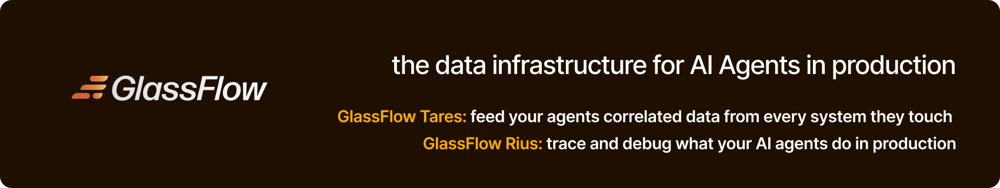

  <a href="https://www.glassflow.ai">Website</a> ·
  <a href="https://docs.glassflow.ai">Docs</a> ·
  <a href="https://www.glassflow.ai/blog">Blog</a> ·
  <a href="https://x.com/glassflowdev">X</a> ·
  <a href="https://www.linkedin.com/company/glassflow-dev">LinkedIn</a>

GlassFlow builds the data infrastructure for AI agents in production: the
context agents need to act, and a clear view of what they did. Both products
are OpenTelemetry-native and MCP-first, and they're built for long-running,
always-on agents as well as short ones. The goal is agents you can see,
understand and trust in production.

## Rius: agent observability

Catch and debug agent failures in production. Rius is managed, so there is
nothing to host. Point your agents at it and see what they decided, where
they failed and what it cost, while they're still running.

- **Long-running agents.** One session across restarts and subagents, with
  traces that update mid-run.
- **Liveness heartbeats.** A crashed agent doesn't look like a quiet one.
- **MCP both ways.** Agents send traces in, and coding agents like Claude
  Code query them back to find the fix.
- **Privacy controls.** Strip or mask content in your own process, before it
  leaves.
- **Shared views.** Send a read-only window of traces to anyone, no seat
  needed.

[Get started](https://console.rius-glassflow.com/signin?utm_source=github&utm_medium=website&utm_campaign=github_get_started) ·
[Docs](https://docs.glassflow.ai/rius) ·
[Claude Code plugin](https://github.com/glassflow/rius-coding-agents) ·
SDKs for [Python](https://github.com/glassflow/rius-sdk-python) and [TypeScript](https://github.com/glassflow/rius-sdk-typescript)

## Tares: the open-source platform for always-on agents

Agents that run on what happens, not only on what you ask. Connect anything
that emits events. Tares puts every event on one timeline per thing, wakes an
agent the moment it matters, and keeps the answer for the next reader. It's
MIT licensed, runs on your own machine or server, and works with Claude Code,
Cursor and your own agents over MCP.

[Repo](https://github.com/glassflow/tares) ·
[Docs](https://docs.glassflow.ai/tares) ·
[Cookbooks](https://github.com/glassflow/tares-cookbooks)

## More open source

| Repository | What it is |
|---|---|
| [rius-coding-agents](https://github.com/glassflow/rius-coding-agents) | Rius for Claude Code: every session as a live trace |
| [rius-sdk-python](https://github.com/glassflow/rius-sdk-python) · [rius-sdk-typescript](https://github.com/glassflow/rius-sdk-typescript) | OpenTelemetry-native tracing SDKs for agents and LLM apps |
